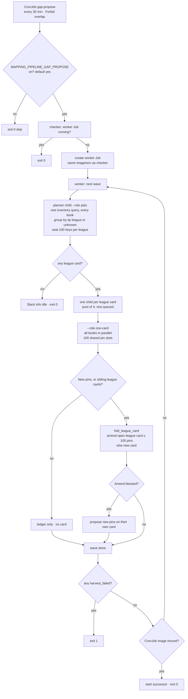
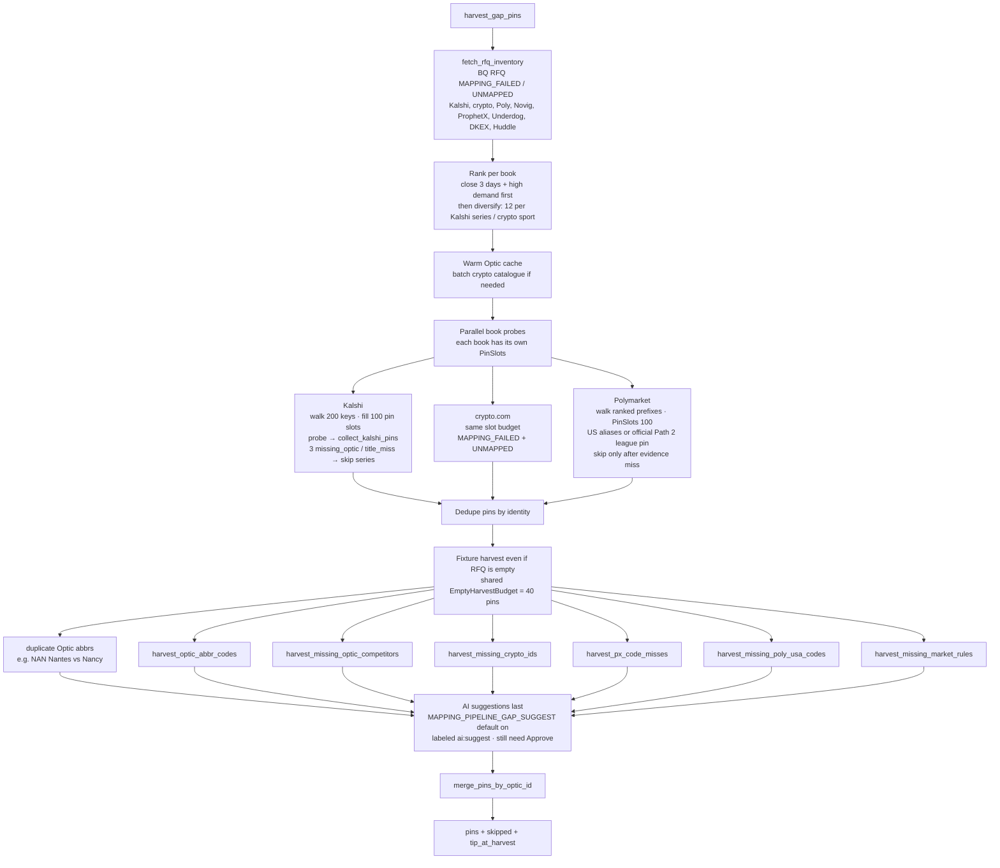

> Retired: the mapping console / tip is not a way to ship mapping. Rules are code — see CLAUDE.md.

# Gap-propose (pipeline gap-fix)

**Audience:** operators switching this CronJob off, and engineers reading
its harvest output.

A gap card is a **list of code changes to make**, not a card to approve.
Turn each real gap into a code change (vocab, venue league catalogue, alias
table; see `CLAUDE.md`), with a test, through the regression gate. Do not
Approve a pipeline card to fix a gap, and do not extend the harvest to draft
more console pins.

## Switching it off

- `MAPPING_PIPELINE_GAP_PROPOSE=0` in
  `deploy/k8s/mapping-console/overlays/*/gap-propose-env.yaml`: the checker
  (`pipeline_gap_drain`) and the legacy `pipeline_gap_propose` both log
  "disabled" and exit 0.
- `MAPPING_PIPELINE_GAP_SUGGEST=0`: no AI suggestion pins (default on).
- Or suspend the CronJob in the overlay (`spec.suspend: true`). A running
  worker Job (`app=gap-propose-worker`) is not stopped by either; delete it.
- The CronJob ships with `deploy:mapping-console:*`; commit the switch to
  the overlay or the next deploy turns it back on.

The mapping-console **Deployment never harvests.** CronJob `gap-propose`
(GKE namespace `mapping-console`, every 30 min) runs
`python -m mappers.control_plane.pipeline_gap_drain --role checker` on the
mapping-console image. The checker lists Batch Jobs labeled
`app=gap-propose-worker`; when none is active it creates a worker Job.
The worker loops until every checkable gap has a ledger outcome, then exits
with an **info** Slack when the unchecked page is empty.

The worker runs in **waves**:

1. A planner child (`--role plan`) runs **one** inventory query. It returns up
   to 5000 unmapped keys per RFQ book: Kalshi, crypto.com, Polymarket, Novig,
   ProphetX, Underdog, DKEX, and Huddle. It then groups **every** key by tip
   league. Novig outcome ids and ProphetX events get their league from one
   batched lookup (`novig_raw`, `px_events_fetch_raw`). A key the tip has no
   rule for goes to the `unknown` card. The planner also records unknown RFQ
   platforms once per wave.
2. Each league card seats at most **100** keys (`CARD_KEYS`). The seats are
   split evenly across the books with a gap in that league, highest demand first.
   Seats a book cannot use go to books with more keys. Keys without a seat stay
   unchecked for the next wave.
3. One child process per league card (`--role one-card`), `MAPPING_GAP_DRAIN_POOL`
   (default 4) at a time, the rest queued. Inside a child every book harvests in
   parallel and shares **100** pin slots. The card warms Optic for its own
   league only. New pins fold into that league's open pipeline card (see
   Checker and worker); walked keys go on the ledger either way.
4. After the wave the worker reads CronJob `gap-propose`. When that image
   differs it starts a successor and exits. Otherwise it plans the next wave.
   Two waves in a row with no progress on any card is a stall.

Walked keys that do not pin are terminal on the ledger (`skipped`,
`needs_probe`, …) and stay out of the fetch until an activated change reopens
their league (see Gap ledger below). The worker has **no**
`activeDeadlineSeconds`; prod worker memory is 4Gi via `GAP_PROPOSE_MEMORY_LIMIT`
(test 2Gi), shared by every child in the pool. The worker image is the checker
pod's image when the Job is created. Empty-fixture sweepers stay on the legacy
`pipeline_gap_propose` one-off path so a league card stays one league.

Legacy manual path: `python -m mappers.control_plane.pipeline_gap_propose`
(still merges sibling pipeline cards for one-off runs).

Manifest: `deploy/k8s/mapping-console/base/gap-propose-cronjob.yaml`
(`*/30`, `concurrencyPolicy: Forbid`, checker pod 256Mi). Worker RBAC:
`gap-propose-role.yaml` (`jobs` get/list/create, `cronjobs` get, `pods` get).
RoleBinding subject must name `mapping-control-plane` in namespace
`mapping-console` (CI cannot patch Roles; apply once per cluster if deploy
fails). BQ: `mapping-control-plane` GSA needs `dataEditor` on
`markets_us.mapping_gap_ledger` and `mapping_harvest_ttl` (mm-infrastructure
`mapping_control_plane_iam.tf`; table DDL alone is not enough). Kill switch:
`MAPPING_PIPELINE_GAP_PROPOSE=0`.

## Checker and worker

Never activates the BQ tip itself (the CronJob runs with
`MAPPING_CP_ALLOW_ACTIVATE=0`). Approving a card in the console would write
the tip; that is retired, so read the card and make code changes. The drain folds each wave into the league's
open pipeline cards (`fold_league_card`). A card belongs to a league by its
`pipeline gap-fix · {league}` note, else by the one league its pins name.
Smallest cards fold first, while the amended card stays at or under **100**
pins (`CARD_PIN_CAP`); past that the wave opens a new card. When the amended
card is blocked in verify, the wave's new pins are proposed on their own card
so an old pin cannot block them.

Open Review cards still exclude their alias keys from the next harvest
(`gap_keys_on_open_review`). Expect one open pipeline card per league, plus
overflow cards once a league passes 100 pins. An amend re-validates the card,
so Proposed shows it as validating until the new pins are checked.

## Harvest

Two layers: RFQ demand probes in parallel, then empty-RFQ fixture
sweepers that still draft when inventory is empty.

AI suggestion pins skip the live `names_fit` probe (unique-bind already
failed it) and append last, labeled `ai:suggest`. They are guesses: never
copy one into code without checking the venue's typed fields. Set `MAPPING_PIPELINE_GAP_SUGGEST=0` to disable.

## Budgets this tick

Constants live in `mappers/control_plane/gap_inventory.py`. Two different
units: **walk** (how many inventory keys to look at) vs **pin slots**
(how many of those keys are allowed to draft). A walked key that
`missing_optic` / `already_mapped` / `title_miss` does **not** consume a
pin slot.

| Cap | Value | Unit | Applies to |
|---|---|---|---|
| `MAX_PROBE` | 200 | keys walked | Kalshi + crypto RFQ inventory (each book) |
| `MAX_EVENTS` | 100 | pin-producing keys | Kalshi, crypto, Poly RFQ sides (each book) |
| `INVENTORY_PAGE` | 5000 | keys fetched | each RFQ book, including Polymarket prefixes |
| `MAX_PER_BUCKET` | 12 | keys walked (first pass) | Kalshi series / crypto sport only |
| `MAX_SLOT_MISSES` | 3 | consecutive misses | then skip that series for 24h (BQ TTL); legacy path only |
| `MAX_EMPTY_HARVEST_PINS` | 40 | pins drafted | shared across three empty-RFQ sweepers |

### `MAX_EVENTS` vs `MAX_PROBE`

Kalshi and crypto keys are **per event** (`KXMLBGAME-…`,
`NX.F.OPT.FIFA-…`). Most walked keys do not pin: Optic is missing, the
title does not bind, or the alias is already on the tip. Harvest
therefore walks a larger candidate pool than it is allowed to draft.

- `MAX_PROBE` (200) is the ranked RFQ list `fetch_rfq_inventory` keeps
  per book. `fill_kalshi_slots` / `fill_crypto_slots` walk that list.
- `MAX_EVENTS` (100) is `PinSlots`: one count per inventory key that
  actually drafted a pin. When a book hits 100, that book's probe
  **stops**, even if unused probe keys remain.

Example: 200 ITF tickers on the list, 150 `missing_optic`, 50 unique
binds → 50 pin slots used, probe list exhausted. Or 100 tickers pin on
the first 100 keys → stop, leave the other 100 unwalked until a later
tick (rank still puts close / high-demand first).

Poly RFQ uses the same `PinSlots(MAX_EVENTS)` and the same inventory page
(`INVENTORY_PAGE`) as the other books.

Underdog, DKEX, and Novig keys draft a `mapping_league` when Optic has the
league and the tip does not wire that book (`gap_fix_listed_onboard`). The
evidence is the Underdog UDX venue token or the DKEX symbol league through the
static venue maps, then the tip row or `optic_spine.csv` for the Optic id.
Novig uses its own event's `opticOddsId`. A tip row that already owns the Optic
league only gets the book enabled; an enabled exchange is never re-tokened.
Keys with no single Optic league stay `needs_league` / `needs_probe`. Huddle
selection ids carry no league, so Huddle stays `needs_probe`. ProphetX onboards
tournaments through `harvest_px_rfq_onboard`. A tournament already on the tip
is probed with the shared PX name bind and stamped on the RFQ key;
`needs_probe` stays only when that probe cannot run. A wired Underdog code
pins from the team catalog, or from one Optic abbreviation. A total or spread
with no selection code pins both Optic abbreviations; a player prop whose
teams are already coded stays `needs_code`. No Optic fixture stays
`needs_probe`. A Novig key whose league is already
on the tip closes from `competitor.opticOddsId` / `player.opticOddsId` and the
market type: a mapped game is `already_mapped`, an ignored type is
`out_of_scope`, and a team or player market with no Optic id is `missing_optic`.

### Gap ledger (`MAPPING_GAP_LEDGER`, default on)

Each tick classifies every inventoried RFQ key as `pinned`, `skipped`,
`needs_league`, `maker_lag`, `not_walked`, etc., and optionally inserts
into `markets_us.mapping_gap_ledger` (no-op if the table is missing).
Every **walked** key records a skip reason for that key before the ledger
write (the probe kind, `aliases_complete` when the probe drafted nothing, or
`walk_without_outcome` if a walk still has neither a pin nor a skip). A pin
folded onto another Optic id still counts as pinned for every key it covered.
A second pin for the same team keeps its book and its lines on the pin that
stays, including an Underdog total folded onto a Kalshi code.
New rows do not use `no_pin`. A Kalshi price series (`15M` candles, the
daily form of that same root, and index futures) and a golf futures series
with no fixture (`KXPGATOP20` and the same family) are `out_of_scope`
(expected residual). Other unwired series stay `title_miss`. A Polymarket
prefix that already has its stamp and drafted no new alias is
`prefix_satisfied` (expected residual). Older rows may still say
`stamp_residual`; that reason is the same residual. `KXITFMATCH` / `KXITFWMATCH`
seat on `itf_men` / `itf_women` when those leagues are on the tip.
`KXNCAAF1H`, `KXNFL1H`, and `KXNFL1Q` use the same team codes as the full
game: the mapper parses the first-half and first-quarter moneylines, and a
missing Optic fixture stays `missing_optic`. A card the
verify gate refuses records that gate's reason on the pins that failed.
A Kalshi event for people (boxing, MMA, tennis) reads each side's code off
that side's market: the suffix of `{event_ticker}-{code}` whose `yes_sub_title`
is the fighter. (Reading the code off the market ticker suffix is ticker
parsing and is debt under `CLAUDE.md`; replace it with a typed field such as
`custom_strike` when touched.) The event tail is the markets' suffixes glued together
(`WHITTAC` is `WHITTA` + `C`) and Kalshi says not to parse tickers, so the tail
is never split for people. No markets, or two markets for one fighter, stays
`disambig`. A UFC method, round, or distance series does not name the
fighters on its own markets; the probe reads those names off the sibling
`KXUFCFIGHT` event. An ATP or WTA game total reads its players off the
sibling match event the same way. A wired Underdog total or spread has no selection
code, so the probe pins the two Optic abbreviations in the event instead
of leaving the key `needs_probe`. Team events try the same read first and fall back to the ticker
grammar (ticker parsing; debt under `CLAUDE.md`). The markets are fetched in any status: a tennis or fight market settles
within hours, and a `status=open` fetch returned nothing for the keys still owed
(only the series listing stays open-only). The pin's evidence also carries each
market's `custom_strike` participant id as
`kalshi:code:<code>:competitor:<uuid>`; it is evidence, not an alias kind.
A crypto.com catalogue row names its two sides in `meta_home_participant` /
`meta_away_participant`. The Optic match and league discovery read those first
and split `meta_name` only when a participant is missing.
A catalogue club whose only difference from the Optic name is the word
`and` (`Bosnia and Herzegovina` / `Bosnia-Herzegovina`), or `St` versus
`Saint` (`St. Vincent and the Grenadines` / `Saint Vincent and the
Grenadines`), matches through `names_fit`. A shorter country name does not.
A friendly whose two sides are not on that day's Optic card is
`missing_optic` and is not pinned. `name_mismatch` stays when one of those
sides is on the card and the other name does not fit.
Unknown `rfq_latest.platform` values outside
`mappers/control_plane/rfq_platforms.py` log a warning with demand counts.

A terminal row keeps its key out of the next fetch. Activating any change (a
drain card, Editor, Chat, or Cart) writes `league_reopen` for every league it
touches. A new or edited league row also reopens `unknown`. A reopen lifts
only ledger rows written **before** it, so the key is walked once more and its
new row is ignored again.

`horizon_wait` (kickoff beyond the league's Optic horizon) is not terminal.
The inventory anti-join skips it for 24h (`HORIZON_WAIT_HOURS`), then the key
is walked again, so it comes back once kickoff is inside the horizon.

### Kalshi / crypto walk (`gap_fix_slots`)

- **One mapping read per card.** `gap_mapping_batch.lookup_mappings_batch`
  resolves every Kalshi or crypto key with one `market_mapping` query. A
  published row still skips the live catalogue. Mapper Chat keeps the
  single-key `lookup_mapping`.
- **Eight-key windows.** Each round probes `PREFETCH_WORKERS` (8) keys
  together, then drafts them one at a time. The walk stops before the next key
  once the slots fill or `yield_fn` fires. Keys that were probed but never
  drafted are not added to `walked`, so they stay `not_walked` (non-terminal).
- **Skips before any HTTP** (`gap_fix_preprobe`). An ignored Kalshi prefix
  (`title_miss`) or a league with no Optic id (`missing_optic`) retires the
  whole series at once, for 24h on the legacy CronJob. The drain never reads
  or writes that dead-bucket TTL and never skips a series: each key gets its
  own ledger outcome (still no HTTP for these). A series skip would leave keys
  unchecked, so inventory would never empty and the worker would stall. A kickoff beyond the
  horizon (`outside_horizon`) skips only that key and becomes a `horizon_wait`.
  An unwired crypto token is still probed live, because `league_not_wired`
  drives crypto league onboarding.

### Why empty-harvest pins are shared (not per book)

RFQ inventory only sees `MAPPING_FAILED` / `UNMAPPED` leftovers. Several
miss classes never produce an RFQ row (empty Optic abbr on Coverage,
UFC `crypto_id` with Kalshi already mapped, Kalshi `BBR` on a longer
canonical). Those sweepers run **after** RFQ harvest, against the same
in-process Optic fixture cache.

`EmptyHarvestBudget` (40) is one counter shared by, in order:

1. `harvest_optic_abbr_codes`
2. `harvest_missing_optic_competitors`
3. `harvest_missing_crypto_ids`

They are not independent books. They all walk close Optic fixtures and
materialize pins + catalogue rows in the same 2–4Gi CronJob. Prod
Sunday OOM'd at ~126 empty pins plus a full cache; test was already
proposing ~52 in 2Gi. A per-sweeper 40 would stack to 120 — the number
that OOM'd. Sharing means the later sweepers inherit whatever the
earlier ones left.

Each sweeper also has its own per-league inner cap (`MAX_PER_LEAGUE`
8–12) so one NFL week or tennis draw cannot spend the whole 40.

Not on this budget: duplicate-abbr soccer pairs, PX code misses, Poly
US close codes (`PinSlots(MAX_EVENTS)` of their own), market-rule
pins, and AI suggestions.

### Polymarket prefixes

`MAX_PER_BUCKET` diversifies **event-level** Kalshi / crypto keys: the
first pass keeps 12 keys per series, then overflow backfills the page.
Polymarket RFQ keys are **slug prefixes / US inners** (`efl`, `nba`, `ufc`),
one per league, so they are not bucketed. They use the same inventory page
as every other book (`INVENTORY_PAGE`, 5000). A drain league card then
seats that prefix with the other venues for the league. There is no
separate 48-prefix cap.

Combat inners are ordered first on the empty-RFQ Poly US sweeper.

### Which lever to pull

There are too many constants to treat as a control panel. Most are
**allocation** (which pins this tick), not **capacity**. Only two axes
trade harvest against the CronJob. Do not turn both, and do not touch
diversity constants for OOM or timeout.

| Lever | Cost | Today's knobs |
|---|---|---|
| **Walk** | CPU, BQ, HTTP, wall clock (~20 min prod / ~40 min test; 60 min deadline) | `MAX_PROBE` 200, `INVENTORY_PAGE` 5000 |
| **Pins drafted** | RSS + verify/submit (test 2Gi / prod 4Gi) | `MAX_EVENTS` 100 per RFQ book, `MAX_EMPTY_HARVEST_PINS` 40 |

`MAX_EVENTS` vs `MAX_PROBE` must stay two units: event books miss a
lot, so harvest walks more keys than it may draft. Poly RFQ
`PinSlots(100)` is slack — the walk is already 48 prefixes. The extra
pin leak is Poly US close (`PinSlots(MAX_EVENTS)` of its own, **not**
on the empty-40).

| Symptom | Pull | Do not pull |
|---|---|---|
| OOMKilled / `mem_pct` spike / Sunday crypto_missing | Empty pin budget; put Poly US close on that budget before raising memory again | `MAX_PROBE`, `MAX_PER_BUCKET` |
| DeadlineExceeded / Forbid skip / harvest > 30 min | `MAX_PROBE`, then `INVENTORY_PAGE` | Empty 40, memory limits |
| ITF fills the probe list; Liga/UFC starved | `MAX_PER_BUCKET` | `MAX_EVENTS` |
| Same Optic-less series burns walk all day | Offline skip in `gap_fix_preprobe`, then `MAX_SLOT_MISSES` / 24h dead-bucket TTL | Walk size |
| NFL week / tennis draw eats empty pins | `MAX_PER_LEAGUE` (8–12, per sweeper) | Empty 40 (unless OOM) |
| Tail Poly prefixes never appear | `INVENTORY_PAGE` | Bucket cap (Poly is not bucketed) |
| Card is noisy with guesses | `MAX_AI_SKIPS` 8 / `MAX_MARKET_RULES` 16 | Resource limits |

Inner constants that are **not** resource levers:
`MAX_PER_BUCKET`, `MAX_SLOT_MISSES`, `MAX_PER_LEAGUE`,
`MAX_MISSING_PINS` (redundant with the shared 40),
`MAX_MARKET_RULES`, `MAX_AI_SKIPS`.

Do not add more caps. A later code collapse would be one tick-wide
`harvest_pins` counter (RFQ books split it; empty sweepers including
Poly US close share the rest). Until then, use the table above.

## Tick outcomes

| `action` | Exit | Meaning |
|---|---|---|
| `skip` | 0 | No new pins (empty harvest or already in Review) |
| `proposed` | 0 | One Review card; Slack warning with URL |
| `blocked` | 0 | Verify/submit blocked; Slack warning; do not re-harvest under Forbid |
| `harvest_failed` | 1 | Harvest raised; Slack critical. If sibling merge already proposed, that card is kept (may be stale) |

## Code map

| Piece | Module |
|---|---|
| CronJob entry | `mappers/control_plane/pipeline_gap_propose.py` |
| Harvest | `mappers/control_plane/gap_fix.py` (`harvest_gap_pins`) |
| Inventory + rank | `mappers/control_plane/gap_inventory.py` |
| Slot fill | `mappers/control_plane/gap_fix_slots.py` |
| Draft + Cart Verify kernel | `mappers/control_plane/pin_flow.py` |
| Batch verify / submit | `mappers/control_plane/gap_fix_verify.py`, `gap_fix_verify_loop.py` |
| Tests | `tests/control_plane/test_pipeline_gap_propose.py` |

Mapper Chat, Unmapped Why, Editor, and Cart Verify share the same
`pin_flow` kernel. Chat never runs `harvest_gap_pins`.

## Related

- [`control-plane-api.md`](control-plane-api.md) — HTTP API, including
  `POST /review/combine-pipeline`
- [`console-deploy.md`](console-deploy.md) — GKE overlay that deploys
  this CronJob
- [`../rfq-mapping-gap-classification.md`](../rfq-mapping-gap-classification.md)
  — true gap vs maker-lag vs residual
- `.cursor/skills/rfq-unmapped-leg-coverage/SKILL.md` — coverage push
- `.cursor/rules/teach-gap-sweeper.mdc` — older guidance; where it says to
  teach the console, make the code change instead
